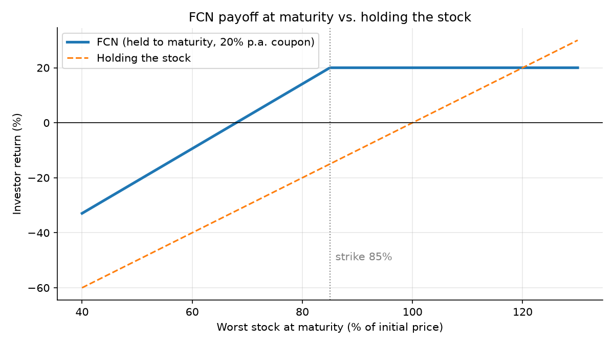
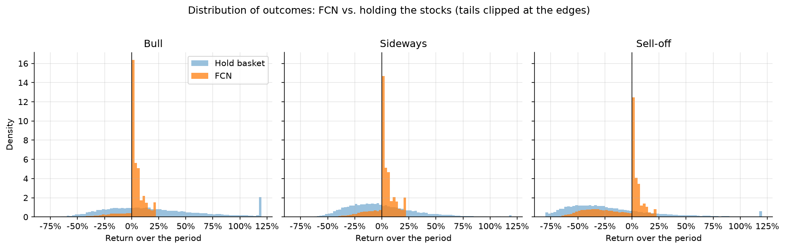
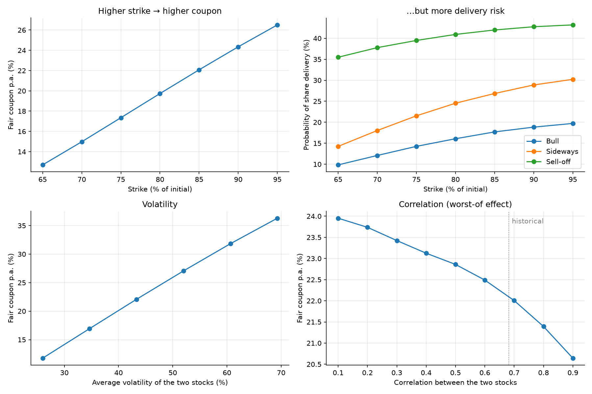
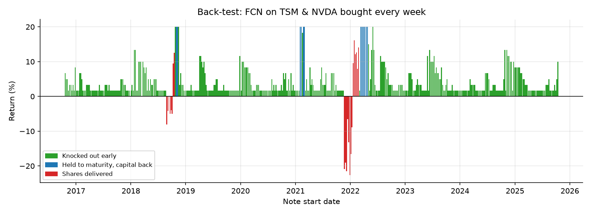

# FCN Risk Simulator

**How does a worst-of Fixed Coupon Note (FCN) behave in different markets, and where does its risk come from?**

A Monte Carlo model in Python that prices a worst-of FCN on **TSMC (TSM) and NVIDIA (NVDA)**, compares its outcomes with simply holding the stocks in bull, sideways and sell-off markets, measures how strike, volatility and correlation drive the coupon and the risk, and back-tests the note on ten years of real prices.

> Status: core model complete; extensions in progress (see Roadmap).

## What is an FCN?

A Fixed Coupon Note pays a fixed monthly coupon. Each month, if **all** underlying stocks are at or above their starting price, the note ends early ("knocks out") and the investor gets their money back. If it never knocks out and the **worst** stock finishes below the strike (e.g. 85% of its starting price), the investor receives that stock at the strike price instead of cash.

In option terms, the investor is **selling a put option on the worst of several stocks**. The high coupon is the premium for that risk.



## Product terms modelled

| Term | Value |
|---|---|
| Underlyings | TSM, NVDA (worst-of) |
| Tenor | 12 months, monthly observations |
| Knock-out | 100% of initial (all stocks) |
| Strike | 85% of initial, physical delivery |
| Coupon | Set at fair value minus a 2% p.a. issuer margin |

## Method

1. **Market data** – daily adjusted prices from Yahoo Finance; volatility and correlation estimated from 3 years of daily log returns.
2. **Simulation** – 20,000 correlated geometric Brownian motion paths (Cholesky decomposition of the correlation matrix).
3. **Pricing** – the fair coupon is found under the risk-neutral measure, so that the present value of coupons plus capital returned equals 100%.
4. **Scenarios** – bull (+20% drift), sideways (0% drift, lower volatility) and sell-off (−20% drift, higher volatility), compared with holding an equal-weight basket of the stocks.
5. **Sensitivity** – fair coupon and delivery probability across strike, volatility and correlation.
6. **Back-test** – the same note bought every week over the past decade, using actual prices.

## Key findings

Results from the latest run (prices to 20 Oct 2026; TSM volatility 40%, NVDA 47%, correlation 0.68).

| | Bull | Sideways | Sell-off |
|---|---|---|---|
| Knock-out probability | 80% | 69% | 56% |
| Average life (months) | 4.6 | 5.6 | 6.6 |
| Share delivery probability | 18% | 27% | 42% |
| FCN expected return | 2.8% | 2.4% | −8.5% |
| FCN worst 5% outcome | −17% | −20% | −50% |
| Basket expected return (12 months) | 22.2% | 0.0% | −18.1% |
| Basket worst 5% outcome | −41% | −43% | −69% |

1. **Pricing.** With ~43% average volatility and 0.68 correlation, the fair coupon is **22.1% p.a.**; after a 2% issuer margin, clients would be offered about **20% p.a.**
2. **The FCN wins when markets go nowhere or fall moderately, and loses badly in a rally.** It returns 2.4% vs 0.0% for the stocks in a sideways market and −8.5% vs −18.1% in a sell-off, but only 2.8% vs 22.2% in a bull market, because the upside is capped at the coupon.
3. **Reinvestment risk.** In a bull market the note knocks out early 80% of the time (average life 4.6 months), so the headline 20% coupon is earned only briefly.
4. **The coupon cushions small falls, not large ones.** In a sell-off, 42% of notes end in share delivery and the worst 5% lose 50%.
5. **Strike trade-off.** Lowering the strike from 95% to 65% cuts the fair coupon from 26.5% to 12.7%, and halves the sideways-market delivery probability (30% → 14%).
6. **Worst-of effect.** The fair coupon rises from 20.6% at 0.9 correlation to 24.0% at 0.1: the less the stocks move together, the more likely one of them falls sharply.
7. **Back-test.** Of 452 notes started weekly from Oct 2016 to Oct 2025, 92% knocked out early and 5% ended in delivery (average return 3.9%, worst −22.7%). Losses cluster in notes started just before the 2018 and 2022 tech sell-offs.





## Limitations

- GBM assumes constant volatility and normally distributed returns; real markets have volatility clusters and jumps, so crash risk is likely **understated**.
- Dividends, funding costs and the issuer's credit risk are ignored.
- Scenario drifts and volatility levels are illustrative assumptions, not forecasts.
- Back-test windows overlap, and use today's coupon rather than the coupon available at each start date.
- **Selection bias:** NVDA rose about 130× and TSM about 17× over the back-test decade. Choosing two of the decade's biggest winners makes the historical results look far better than a typical FCN would.

## Roadmap

- [ ] Replace constant volatility with a **GARCH(1,1)** forecast
- [ ] Train a **neural network (TensorFlow)** as a fast surrogate model that estimates the fair coupon and delivery risk directly from product terms
- [ ] Add Hong Kong underlyings and features such as a knock-in barrier or step-down knock-out

## How to run

```bash
pip install -r requirements.txt
jupyter notebook fcn_risk_simulator.ipynb
```
Run all cells. Tickers and product terms can be changed in the **Settings** section.

---
*For educational purposes only. Uses public market data only; not investment advice.*
